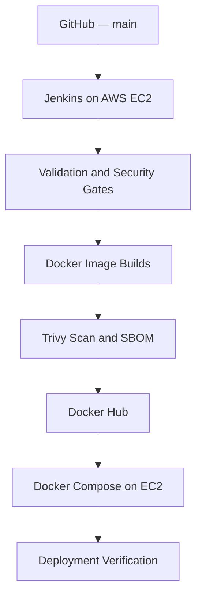

# RenewGrid — Jenkins CI/CD on AWS EC2

**Elevate Labs | DevOps Internship — Task 2**

A Jenkins-based CI/CD implementation for RenewGrid, a containerized React, FastAPI, and PostgreSQL application. The pipeline automatically validates source changes, executes tests and security scans, builds versioned Docker images, publishes them to Docker Hub, and deploys the application using Docker Compose on AWS EC2.

**[CI/CD Documentation](DEVOPS-TASK2.md) · [Verified Execution](evidence/jenkins/jenkins-verification.md) · [Docker Hub — Backend](https://hub.docker.com/r/fire2686/renewgrid-jenkins-api) · [Docker Hub — Frontend](https://hub.docker.com/r/fire2686/renewgrid-jenkins-web)**

## Overview

RenewGrid is an e-waste recycling and rewards management platform with four application roles:

- **User:** Submits e-waste, receives price estimates, schedules pickups, tracks collection, and manages rewards.
- **Collector:** Manages assigned pickups, verifies collection through QR codes, and uploads collection evidence.
- **Recycler:** Processes collected waste, manages recycling decisions, and records processing activities.
- **Administrator:** Manages users, pickup assignments, pricing rules, analytics, and reports.

The application uses a React frontend served by Nginx, a FastAPI REST API, and PostgreSQL for persistent data. Alembic manages database schema migrations.

This repository focuses on automating the application's delivery through Jenkins while retaining its existing functionality.

## Technology Stack

| Category               | Technologies                       |
| ---------------------- | ---------------------------------- |
| Version control        | Git, GitHub                        |
| CI/CD                  | Jenkins                            |
| Infrastructure         | AWS EC2, Ubuntu Linux              |
| Containerization       | Docker, Docker Compose             |
| Container registry     | Docker Hub                         |
| Security scanning      | Trivy                              |
| Test and build tooling | pytest, Node.js, npm, Vite, ESLint |
| Software supply chain  | CycloneDX SBOM                     |
| Frontend               | React, Nginx                       |
| Backend                | Python, FastAPI, Uvicorn           |
| Database               | PostgreSQL                         |
| Database migrations    | Alembic                            |

## CI/CD Architecture



The deployed application uses four Docker Compose services:

| Service   | Responsibility                                    |
| --------- | ------------------------------------------------- |
| `db`      | Persistent PostgreSQL database                    |
| `migrate` | One-time Alembic database migrations              |
| `api`     | FastAPI backend                                   |
| `web`     | Nginx-hosted React frontend and API reverse proxy |

The database and API are not directly published to the internet. The frontend is bound to the EC2 instance's loopback interface and accessed through SSH port forwarding.

Jenkins is also accessed through an SSH tunnel. No purchased domain or public application load balancer is required for this demonstration.

## Jenkins Pipeline

The Jenkins pipeline is defined in the repository's [`Jenkinsfile`](Jenkinsfile).

| Stage                   | Purpose                                                        |
| ----------------------- | -------------------------------------------------------------- |
| Checkout                | Retrieve the selected Git commit                               |
| Secret Scan             | Execute repository secret scanning                             |
| Backend Tests           | Run automated Python tests                                     |
| Frontend Validation     | Install dependencies, build React, and run ESLint              |
| Docker Build            | Build frontend and backend container images                    |
| Image Security Scan     | Check container images for configured vulnerability severities |
| Generate SBOM           | Produce CycloneDX software bills of materials                  |
| Docker Hub Publish      | Publish commit-tagged container images                         |
| Deploy to EC2           | Deploy the application through Docker Compose                  |
| Deployment Verification | Check frontend, API, and database-dependent functionality      |

Jenkins detects changes in the configured Git branch and starts the pipeline automatically.

A failed required validation or security stage prevents subsequent release stages from executing.

For implementation details, see [DEVOPS-TASK2.md](DEVOPS-TASK2.md).

## Verified Execution

**Jenkins Build #7 completed successfully on October 24, 2026.**

| Verification            | Recorded result          |
| ----------------------- | ------------------------ |
| Trigger                 | Started by an SCM change |
| Git branch              | `main`                   |
| Commit                  | `81860ebf42a1`           |
| Backend tests           | 26 passed, 3 warnings    |
| Frontend build          | Passed                   |
| Frontend lint           | Passed                   |
| Image security scan     | Passed                   |
| SBOM generation         | Passed                   |
| Docker Hub publishing   | Passed                   |
| EC2 deployment          | Passed                   |
| Deployment verification | Passed                   |

The pipeline reported a total duration of **54 seconds**.

**Verified commit:** [`81860ebf42a1`](https://github.com/Aoun62336/RenewGrid-Jenkins-CICD/commit/81860ebf42a1781fdcccfaa2fa3a21538be32a0e)

The complete results, image digests, and execution evidence are documented in [Jenkins Verification](evidence/jenkins/jenkins-verification.md).

### Published Container Images

**Backend**

```text
docker.io/fire2686/renewgrid-jenkins-api:sha-81860ebf42a1
```

**Frontend**

```text
docker.io/fire2686/renewgrid-jenkins-web:sha-81860ebf42a1
```

Both images were published successfully to Docker Hub and subsequently pulled during the verified deployment.

## Local Docker Compose Setup

These instructions run the application locally by building images from source. They are separate from the Jenkins-managed EC2 deployment.

### Prerequisites

- Git
- Docker Engine or Docker Desktop
- Docker Compose v2

### 1. Clone the repository

```bash
git clone https://github.com/Aoun62336/RenewGrid-Jenkins-CICD.git
cd RenewGrid-Jenkins-CICD
```

### 2. Configure the application

```bash
cp .env.compose.example .env.compose
```

Edit `.env.compose` and replace the example credential values with independently generated secrets.

Never commit the populated environment file.

### 3. Validate the configuration

```bash
docker compose --env-file .env.compose config --quiet
```

### 4. Start the application

```bash
docker compose --env-file .env.compose up -d --build
```

### 5. Check service status

```bash
docker compose --env-file .env.compose ps -a
```

### 6. Verify the frontend

```bash
curl --fail http://127.0.0.1:8080/nginx-health
```

The application is available locally at:

```text
http://localhost:8080
```

### 7. Stop the application

```bash
docker compose --env-file .env.compose down
```

This stops the application without intentionally deleting its named data volumes.

## Execution Evidence

| Evidence                                                         | Description                            |
| ---------------------------------------------------------------- | -------------------------------------- |
| [Jenkins Pipeline](evidence/jenkins/01-jenkins-pipeline.png)     | Successful pipeline stages             |
| [Backend Tests](evidence/jenkins/02-backend-tests.png)           | Automated pytest execution             |
| [Container Security Scan](evidence/jenkins/03-security-scan.png) | Trivy image scanning                   |
| [Docker Hub Images](evidence/jenkins/04-dockerhub-images.png)    | Published container images             |
| [EC2 Deployment](evidence/jenkins/05-deployment.png)             | Running RenewGrid application          |
| [Automatic Trigger](evidence/jenkins/06-automatic-trigger.png)   | SCM-triggered successful Jenkins build |

Additional machine-readable evidence, including JUnit test results, vulnerability reports, SBOMs, and deployment references, was archived by Jenkins Build #7.

## Security and Deployment Scope

This implementation includes automated validation, secret scanning, image vulnerability scanning, non-root application containers, internal service networking, versioned image tags, and deployment health checks.

It is a **controlled internship demonstration**, not a claim of production high availability or complete security certification.

The Jenkins UI and deployed application are accessed through SSH port forwarding rather than public-facing endpoints. Public deployment would require additional measures such as HTTPS, stronger infrastructure isolation, operational monitoring, backups, and recovery planning.

## Documentation

- [Detailed Jenkins CI/CD Guide](DEVOPS-TASK2.md)
- [Verified Jenkins Build and Evidence](evidence/jenkins/jenkins-verification.md)
- [Backend Application Documentation](backend/README.md)
- [Original RenewGrid Task 1 Implementation](https://github.com/Aoun62336/RenewGrid-DevOps)

---

**Project:** RenewGrid  
**Internship:** Elevate Labs — DevOps Task 2  
**Implementation:** Jenkins CI/CD, Docker Hub, and AWS EC2
