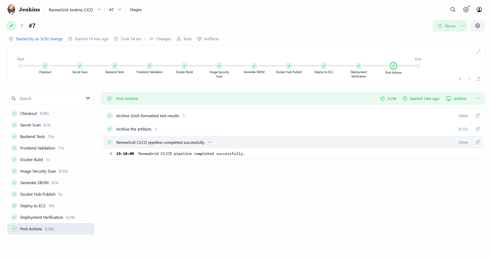
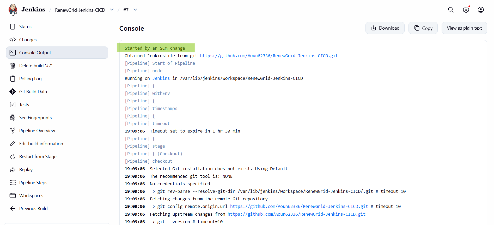

# Jenkins CI/CD — Verified Execution

**Project:** RenewGrid  
**Internship:** Elevate Labs — DevOps Task 2  
**Verification Date:** October 24, 2026  
**Status:** SUCCESS

## 1. Verified Build

| Field               | Value                                      |
| ------------------- | ------------------------------------------ |
| Jenkins job         | `RenewGrid-Jenkins-CICD`                   |
| Build number        | `#7`                                       |
| Build result        | SUCCESS                                    |
| Duration            | 54 seconds                                 |
| Trigger             | Started by an SCM change                   |
| Source branch       | `main`                                     |
| Git revision        | `81860ebf42a1781fdcccfaa2fa3a21538be32a0e` |
| Pipeline definition | `Jenkinsfile`                              |

**[View Verified Git Commit](https://github.com/Aoun62336/RenewGrid-Jenkins-CICD/commit/81860ebf42a1781fdcccfaa2fa3a21538be32a0e)**

Jenkins Build #7 executed automatically after a source change.

The checked-out revision was associated with the merge of Pull Request #11:

**[Documentation Verification Pull Request #11](https://github.com/Aoun62336/RenewGrid-Jenkins-CICD/pull/11)**

The Jenkins dashboard is accessible through the demonstration environment's SSH tunnel rather than a public Jenkins endpoint.

## 2. Pipeline Stage Results

| Stage                   | Result  | Verification                                        |
| ----------------------- | ------- | --------------------------------------------------- |
| Checkout                | SUCCESS | Checked out the recorded Git revision               |
| Secret Scan             | SUCCESS | Repository secret-scanning stage completed          |
| Backend Tests           | SUCCESS | 26 tests passed                                     |
| Frontend Validation     | SUCCESS | Vite build and ESLint completed                     |
| Docker Build            | SUCCESS | Backend and frontend images built                   |
| Image Security Scan     | SUCCESS | No blocking HIGH or CRITICAL findings reported      |
| Generate SBOM           | SUCCESS | Backend and frontend CycloneDX SBOMs generated      |
| Docker Hub Publish      | SUCCESS | Both versioned images published                     |
| Deploy to EC2           | SUCCESS | Application services deployed                       |
| Deployment Verification | SUCCESS | Frontend, API, and database-dependent checks passed |

The pipeline completed successfully after the required stages.

## 3. Backend Test Results

The backend validation stage executed pytest.

Recorded output:

```text
26 passed, 3 warnings in 2.24s
```

The warnings included deprecated API usage identified by Pydantic and SQLAlchemy.

No backend test failures were reported.

Jenkins archived the test results in JUnit XML format:

```text
backend-junit.xml
```

## 4. Frontend Validation

The frontend validation stage:

1. Installed dependencies using `npm ci`.
2. Generated a production build using Vite.
3. Executed ESLint.

Recorded results:

| Check                   | Result     |
| ----------------------- | ---------- |
| Dependency installation | Successful |
| Vite production build   | Successful |
| ESLint                  | Successful |

The Vite build processed 339 modules and completed in approximately 2.20 seconds.

A non-blocking advisory was reported for a large production JavaScript chunk.

## 5. Container Security Scanning

Trivy scanned both application images.

### Backend Image

| Field                           | Result                                            |
| ------------------------------- | ------------------------------------------------- |
| Image                           | `fire2686/renewgrid-jenkins-api:sha-81860ebf42a1` |
| Detected operating system       | Debian 12.15                                      |
| Scan result                     | Passed                                            |
| Blocking HIGH/CRITICAL findings | 0                                                 |

### Frontend Image

| Field                           | Result                                            |
| ------------------------------- | ------------------------------------------------- |
| Image                           | `fire2686/renewgrid-jenkins-web:sha-81860ebf42a1` |
| Detected operating system       | Alpine 3.24.2                                     |
| Scan result                     | Passed                                            |
| Blocking HIGH/CRITICAL findings | 0                                                 |

The reported results reflect the pipeline's configured vulnerability scanning and severity policy at the time of execution.

A passing scan does not establish that an image is permanently free from all vulnerabilities.

## 6. Software Bills of Materials

The pipeline generated CycloneDX SBOM artifacts for both container images.

| Artifact        | Description                         |
| --------------- | ----------------------------------- |
| `api-sbom.json` | Backend software bill of materials  |
| `web-sbom.json` | Frontend software bill of materials |

Both files were archived as Jenkins build artifacts.

These documents support software-component visibility and release traceability.

## 7. Docker Hub Publication

Jenkins successfully authenticated to Docker Hub and published both images.

### Backend

**Image reference:**

```text
docker.io/fire2686/renewgrid-jenkins-api:sha-81860ebf42a1
```

**Published manifest digest:**

```text
sha256:6006bbabb86e874edadaebe1330a2a5853add5c863a295ee8491bd17c7354cd1
```

**[Docker Hub — Backend](https://hub.docker.com/r/fire2686/renewgrid-jenkins-api)**

### Frontend

**Image reference:**

```text
docker.io/fire2686/renewgrid-jenkins-web:sha-81860ebf42a1
```

**Published manifest digest:**

```text
sha256:dc8166fc3ea94caa3ed0e46b90aac039be611cbc0dda40336e943daeb6879e7d
```

**[Docker Hub — Frontend](https://hub.docker.com/r/fire2686/renewgrid-jenkins-web)**

Both images were subsequently pulled during the EC2 deployment stage.

The versioned tags associate the images with the Git revision used by Jenkins.

## 8. EC2 Deployment Verification

The deployment used Docker Compose with four services.

| Service             | Verified state                                                        |
| ------------------- | --------------------------------------------------------------------- |
| PostgreSQL (`db`)   | Healthy                                                               |
| Alembic (`migrate`) | Completed; exit code 0                                                |
| FastAPI (`api`)     | Healthy                                                               |
| Nginx/React (`web`) | Started; health check still starting in the immediate status snapshot |

The deployment verification stage reported:

```text
Frontend, API and database-dependent checks passed.
```

This confirms that the configured runtime checks succeeded after deployment.

The web service was published on the EC2 instance's loopback interface, rather than being directly exposed through a public application port.

## 9. Automatic Trigger Verification

Build #7 began with the recorded cause:

```text
Started by an SCM change
```

The pipeline then checked out the relevant `main` branch revision and completed successfully.

This provides evidence that Jenkins automatically detected a repository change and executed the CI/CD workflow.

No manual build initiation was required for this verified run.

## 10. Archived Jenkins Artifacts

Build #7 archived the following files:

| Artifact                  | Purpose                             |
| ------------------------- | ----------------------------------- |
| `api-deploy-ref.txt`      | Backend deployment image reference  |
| `api-push.txt`            | Backend image publication record    |
| `api-sbom.json`           | Backend CycloneDX SBOM              |
| `api-vulnerabilities.txt` | Backend vulnerability report        |
| `backend-junit.xml`       | Backend test results                |
| `secrets.txt`             | Secret-scanning report              |
| `web-deploy-ref.txt`      | Frontend deployment image reference |
| `web-push.txt`            | Frontend image publication record   |
| `web-sbom.json`           | Frontend CycloneDX SBOM             |
| `web-vulnerabilities.txt` | Frontend vulnerability report       |

These artifacts are retained within the Jenkins build record, subject to the Jenkins instance's artifact-retention configuration.

## 11. Screenshot Evidence

The following screenshots provide visual evidence of the implementation.

| Screenshot                                         | Description                       |
| -------------------------------------------------- | --------------------------------- |
| [01 — Jenkins Pipeline](01-jenkins-pipeline.png)   | Successful Jenkins stages         |
| [02 — Backend Tests](02-backend-tests.png)         | Automated pytest execution        |
| [03 — Image Security Scan](03-security-scan.png)   | Trivy scan results                |
| [04 — Docker Hub Images](04-dockerhub-images.png)  | Published container images        |
| [05 — Deployment](05-deployment.png)               | Running RenewGrid application     |
| [06 — Automatic Trigger](06-automatic-trigger.png) | Successful SCM-triggered Build #7 |

### Jenkins Build Overview



### Automatic Trigger Evidence



## 12. Verification Scope

The successful execution demonstrates that:

- Jenkins checked out a specific repository revision.
- Required source validation stages completed.
- All 26 recorded backend tests passed.
- Frontend build and lint validation completed.
- Both Docker images were built successfully.
- Both image security scans passed the configured gate.
- CycloneDX SBOMs were generated.
- Both images were published to Docker Hub.
- Docker Compose deployed the application on EC2.
- Application and database-dependent verification checks passed.
- Jenkins automatically started the build following an SCM change.

The evidence does not establish complete functional test coverage, production high availability, continuous security certification, or automated recovery from every possible failure.

## 13. Final Result

**Jenkins Build #7 — SUCCESS**

The verified execution demonstrates an automated Jenkins CI/CD workflow connecting GitHub source changes to application validation, container-image publication, Docker Compose deployment, and runtime verification on AWS EC2.

This build provides the execution evidence for Elevate Labs DevOps Internship Task 2.
